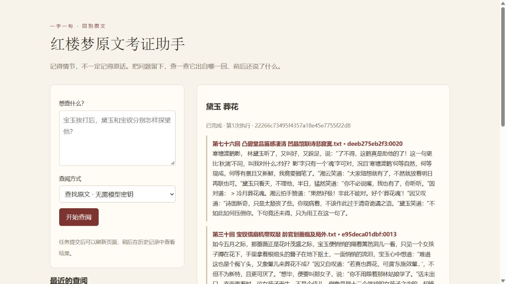
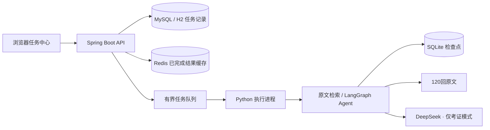

# 红楼梦原文考证助手

我很喜欢《红楼梦》，也想把阅读时冒出来的问题，变成能回到原文核对的东西：某句话是谁说的？发生在第几回？把前后几段一起读，意思会不会不一样？于是做了这个项目。

查这些问题时，关键词搜索适合找原句，但只有一个大致印象时，往往不知道该搜什么；直接问大模型，又容易得到一段流畅的解释，却说不清出处。我希望这个工具能先找到书里的依据，再讨论怎么理解。它现在收录一套120回文本，可以查原文，也可以围绕一个问题做多步查证，把结论和引文一起留下来。

## 可以怎么用

**找一段想不起出处的原文。** 输入“黛玉 葬花”之类的人物和情节词，直接查看相关片段、回目和原文编号。这种查找不调用模型，也不需要 API 密钥。

**比较同一情节里的不同人物。** 比如：

> 依据第三十四回，比较宝钗和黛玉在宝玉挨打后的探望表现，分别给出原文依据，并区分事实与解读。

这类问题通常需要分别找两个人的行动，再回看上下文。考证模式允许模型拆分问题、补充搜索和阅读相邻段落，最后提交带引用的结论。程序会检查引文是否确实来自本次查到的原文。

**查到一半，稍后继续。** 多步查证需要等待，也可能遇到接口超时或调用额度用完。任务中心会保存状态，刷新页面后仍能查到结果；未完成的任务可以手动重试，达到预算限制时可以选择增加一轮预算。

## 为什么这样做



上图为“查找原文”模式的实际界面，展示的是候选片段，排序并不等同于相关性判断。

最初的流程是一次检索、一次生成回答。它适合直接的问题，但人物比较、跨段落核对往往需要继续查资料，所以增加了用 LangGraph 组织的 Agent，让模型按证据决定下一步查什么。

同时，执行过程需要有边界：什么时候停止、哪些工具能用、引用是否合法、失败后从哪里继续，都由 Python 执行层控制。这里把这部分称为 Harness，具体实现见 [架构说明](ARCHITECTURE.md)。

Java 部分负责把查证变成可管理的后台任务。提交后立即返回任务编号，浏览器随后查询进度；数据库记录历史，有界线程池限制同时执行的任务，同一请求编号避免重复创建任务。这些功能对应长时间等待、重复点击和服务中断时会遇到的问题。



| 部分 | 当前实现 | 选择的原因 |
| --- | --- | --- |
| 原文检索 | jieba、TF-IDF、余弦相似度 | 语料范围固定，人物名、情节词和原句检索适合作为可检查的基线 |
| 多步考证 | LangGraph、工具调用 | 搜索、读上下文、整理结论可以按问题多次进行 |
| 执行控制 | 调用预算、引用校验、SQLite 检查点 | 避免无休止调用，保存已经找到的证据 |
| 任务服务 | Java 21、Spring Boot、Spring JDBC、MySQL / H2、Redis | 持久化历史、控制并发，缓存已完成结果；H2 模式可直接体验 |
| 页面 | Java 服务内置网页；另有 Streamlit 入口 | 任务中心适合异步查阅，Streamlit 适合普通问答和多轮追问 |

## 开始使用

Python 依赖按 [requirements.txt](requirements.txt) 安装，当前开发环境使用 Python 3.14。任务中心还需要 JDK 21；项目带有 Maven Wrapper，首次启动会下载 Maven 和 Java 依赖。

```bash
git clone https://github.com/lol-beluga/honglou-agent.git
cd honglou-agent
python -m venv .venv
```

Windows PowerShell：

```powershell
.\.venv\Scripts\python.exe -m pip install -r requirements.txt
$env:RESEARCH_PYTHON = (Resolve-Path .\.venv\Scripts\python.exe).Path
$env:RESEARCH_PROJECT_DIR = (Get-Location).Path
# JAVA_HOME 应指向 JDK 21 的安装目录
cd java-service
.\mvnw.cmd spring-boot:run
```

Linux / macOS：

```bash
.venv/bin/python -m pip install -r requirements.txt
export RESEARCH_PYTHON="$PWD/.venv/bin/python"
export RESEARCH_PROJECT_DIR="$PWD"
cd java-service
sh mvnw spring-boot:run
```

打开 [任务中心](http://127.0.0.1:8080)，先选“查找原文”即可体验。首次建立索引会比后续查询慢一些。

要使用“多步考证”，把项目根目录的 `.env.example` 复制为 `.env`，填写 `DEEPSEEK_API_KEY`。模型默认是 `deepseek-chat`；需要修改时，在启动服务的终端设置环境变量 `DEEPSEEK_MODEL`。模型须支持工具调用。

需要 MySQL + Redis 时，按 [服务配置](java-service/README.md#mysql-与-redis) 启动配套服务并启用 mysql 配置。默认仍可用 H2 直接体验。

任务服务默认同时执行2个任务、最多等待8个任务。配置、接口示例和故障处理见 [Java 服务说明](java-service/README.md)。

### 原有的 Streamlit 入口

只使用 Python 也可以运行普通问答与多步考证。在项目根目录激活虚拟环境并运行：

```bash
python -m streamlit run streamlit_app.py --server.address 127.0.0.1
```

打开 [问答页面](http://127.0.0.1:8501)。侧栏可以填写模型密钥、切换模式、恢复任务并导出 Markdown 报告。Windows 也可运行 `start_app.cmd`。

### 命令行

```bash
python agent_cli.py ask "第三十四回中宝钗如何给宝玉送药？"
python agent_cli.py list
python agent_cli.py resume TASK_ID
python agent_cli.py resume TASK_ID --extend-budget
python agent_cli.py show TASK_ID --out outputs/task.json
```

## 验证效果

```bash
# 项目根目录，已激活 Python 虚拟环境
python -m unittest discover -s tests -v
python evaluate.py --dry-run

# 对比普通 RAG 与考证模式，会调用模型 API
python evaluate.py --mode both --limit 1

# Java 服务目录；Windows 使用 .\mvnw.cmd test
sh mvnw test
```

Python 测试覆盖工具与引用校验、预算、检查点恢复和界面。Java 测试覆盖并发重复提交、队列满、失败重试、中断状态和 HTTP 接口。测试中的模型响应使用替身，不产生 API 费用。

评测输出保存在 `outputs/eval-时间戳/`，包含逐题预测、原文召回统计、Token 用量和人工复核表 `review.csv`。附带的6条用例是开发用例，不能据此推断广泛问题上的准确率。引文能在原文里找到，也不等于它充分支持结论，仍需要人工核对。

## 目前的范围

- 语料为一套120回文本，约86.9万字、3110个不超过300字的片段；没有收录版本校勘、脂批或研究论文。
- 检索目前依赖词面匹配。别名、隐晦指代和同义改写可能漏召回；尚未接入语义向量检索或重排模型。
- 任务中心面向单人、单实例使用，默认只监听 `127.0.0.1`，没有账号与任务权限隔离。
- 服务重启会把未完成任务标记为中断，由使用者决定是否重试。检查点能保留进度，但模型响应返回与本地保存之间仍有中断窗口，不能保证恢复时绝不重复计费。
- Java 保存任务状态和结果，Python 保存考证过程；两者共用任务编号。Streamlit / CLI 创建的任务不自动出现在 Java 的历史列表中。

更多实现细节见 [架构说明](ARCHITECTURE.md) 和 [Java 任务服务设计](java-service/DESIGN.md)。
